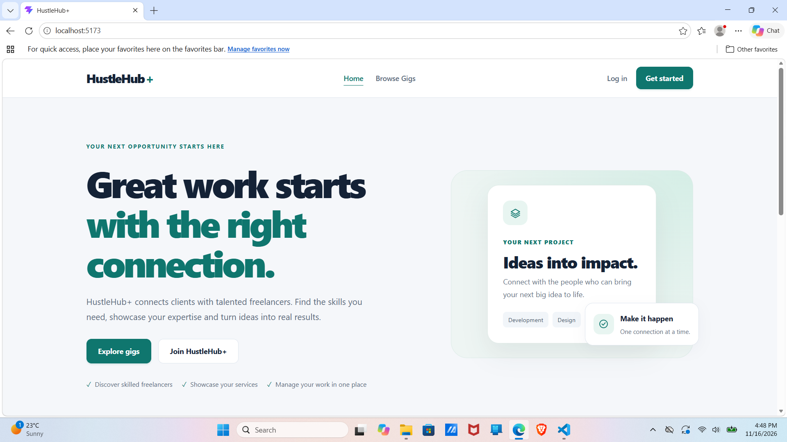
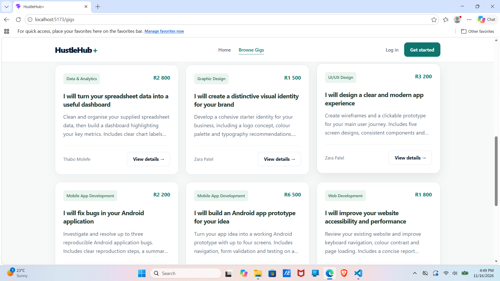
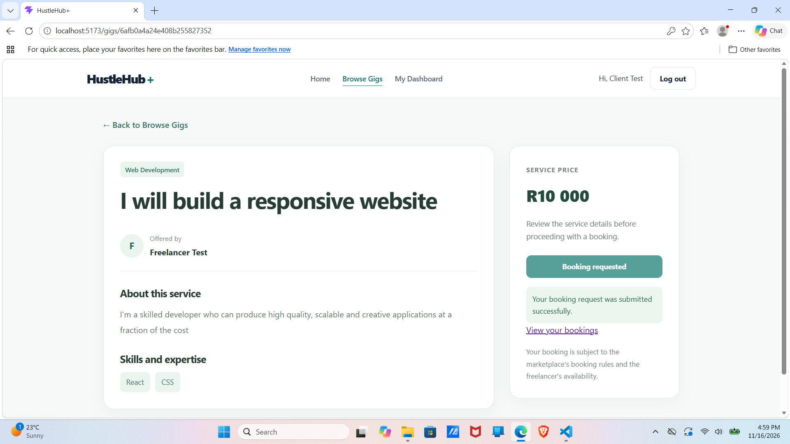
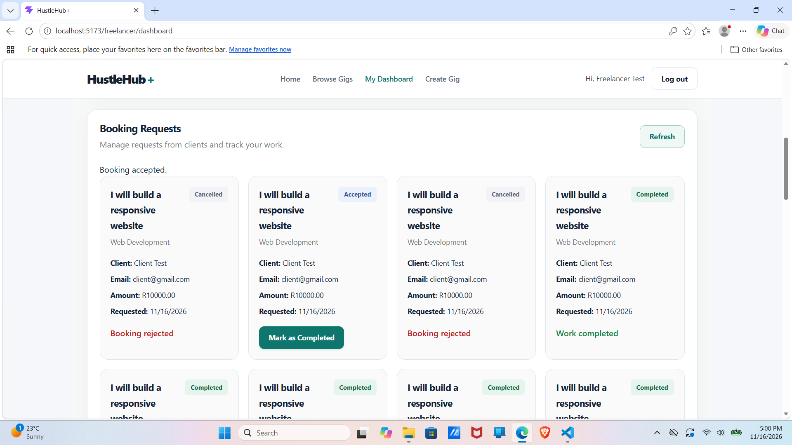
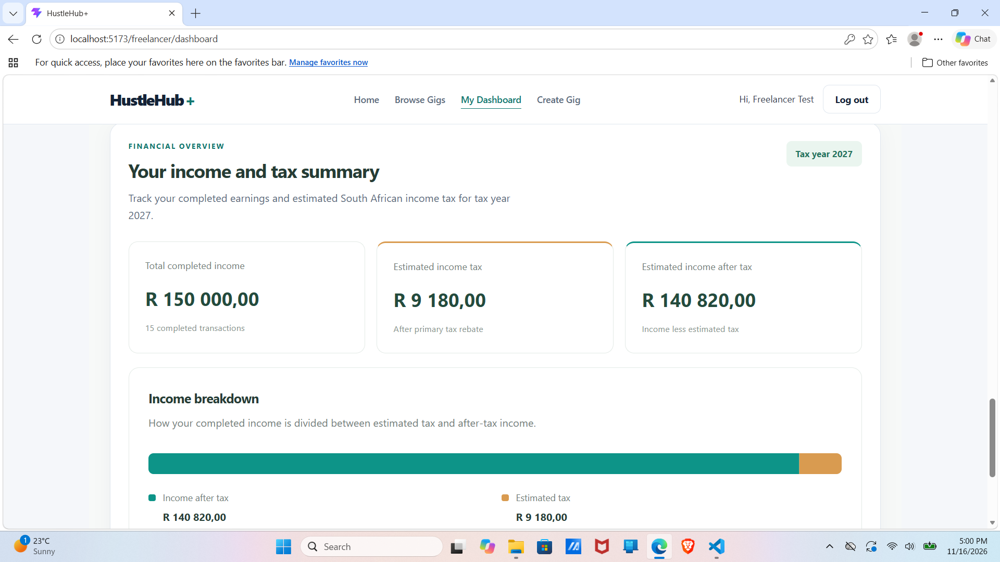
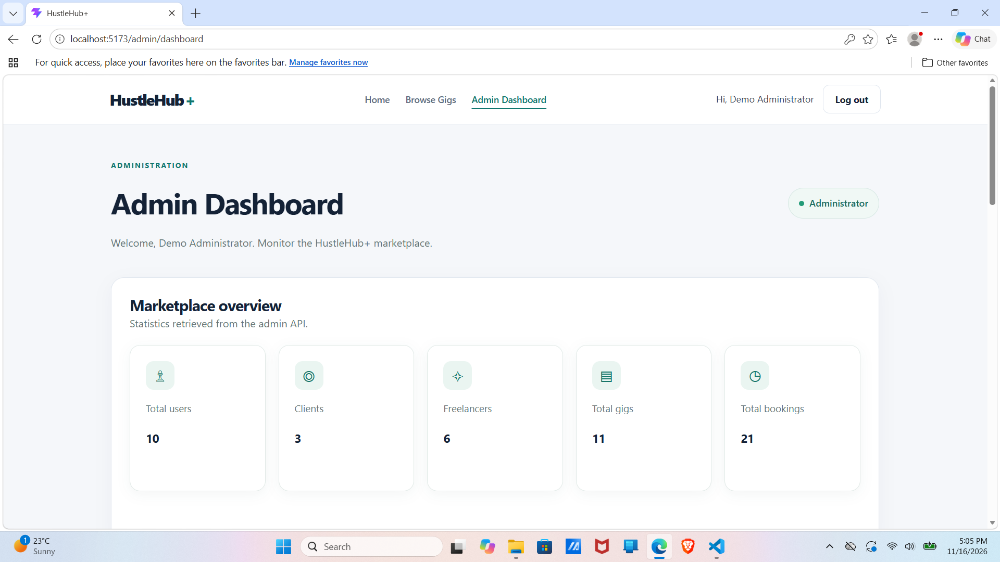

# HustleHub+

A freelance services marketplace built with React, Express and MongoDB. Clients discover services and book freelancers; freelancers manage gigs, respond to requests and track completed-work income. Administrators can view platform statistics, registered users and service listings.


## Preview



**Workflow:** browse services → request a booking → freelancer accepts and completes the work → view completed-work income.

<details open>
<summary>Booking workflow and administrator dashboard - click to minimise</summary>

### 1. Browse freelance services

Clients compare service descriptions, categories, prices and freelancer names.



### 2. Request a booking

The service page confirms a submitted booking request and links to the client's bookings.



### 3. Manage requests as a freelancer

Freelancers review requests, accept or reject pending bookings, and mark accepted work as completed. This view shows accepted, completed and cancelled examples.



### 4. Review completed-work income

The financial overview summarises completed-work income and the estimated tax split. The displayed totals combine multiple demo bookings.



### 5. Monitor the marketplace as an administrator

The administrator overview displays user, role, service and booking counts.



</details>

Screenshots show a local demonstration using test accounts and sample data.

## Features

- Client and freelancer registration with role-based dashboards.
- Searchable service listings and ownership-protected gig management.
- Booking lifecycle: Pending → Accepted → Completed, or Pending → Cancelled.
- MongoDB transactions keep booking and financial records consistent.
- Freelancer income summaries with a fixed 2027 South African income-tax estimate.
- Administrator overview of users, services and platform activity.
- Password hashing, input validation, rate limiting, account lockout and token revocation.
- Responsive layouts, keyboard focus indicators and accessible navigation.

## Security

- Passwords hashed with bcrypt.
- JWT authentication with token revocation on logout.
- Role-based access for clients, freelancers and administrators.
- Ownership checks prevent users from modifying another freelancer’s gigs or bookings.
- Server-side validation and authoritative booking prices.
- Rate limiting and temporary account lockout after repeated failed logins.
- Structured logging with sensitive-value redaction.
- Environment-based secrets excluded from version control.

## Testing and quality assurance

- **Backend unit tests:** authentication, authorisation, validation, booking rules, income reporting and tax calculations.
- **MongoDB integration tests:** booking persistence, transaction rollback, ownership checks and competing status updates against a real local replica set.
- **Frontend component tests:** forms, protected routes, dashboards, booking interactions and error handling.
- **Playwright browser tests:** end-to-end workflows, responsive layouts and navigation.
- **Postman/Newman collections:** API workflows, authentication and security scenarios.
- **Manual testing:** client, freelancer and administrator workflows in a local environment.
- **Static checks:** ESLint and frontend production builds.

OWASP ZAP was used aswell for dynamic security scanning during the original university project.

## Technology

| Layer | Tools |
| --- | --- |
| Frontend | React, Vite, React Router, CSS |
| Backend | Node.js, Express, Mongoose |
| Database | MongoDB replica set |
| Testing | Node test runner, Vitest, Testing Library, Playwright, Postman/Newman |
| Automation | GitHub Actions, optional Docker configuration |

The frontend API service calls Express routes. Authentication, role and validation middleware run before controllers access Mongoose models. Booking writes use a shared database transaction so related records commit or roll back together. The server connects to MongoDB before accepting HTTP requests.

## Local setup on Windows

Requirements: Node.js 22.12+ or Node.js 24, npm and MongoDB Server 8.0. The launcher uses the default Windows MongoDB installation path. Docker and paid services are not required.

Run these commands in PowerShell from the project root:

```powershell
npm.cmd ci --prefix Backend --ignore-scripts --no-audit --no-fund
npm.cmd ci --prefix frontend --ignore-scripts --no-audit --no-fund
node scripts/dev-local.cjs
```

Open [http://localhost:5173](http://localhost:5173). Keep the terminal open while using the application; Ctrl+C stops the processes started by the launcher. Ports 4000 and 5173 must be available.

The launcher starts a local MongoDB replica set named `rs0` on port 27018 with a 256 MiB database cache. It stores data and a generated signing secret in the ignored `.local/` directory. An existing compatible local replica set can be reused; the launcher leaves a reused MongoDB process running when stopped.

For a different MongoDB executable location, set `MONGOD_PATH` before launching:

```powershell
$env:MONGOD_PATH = 'C:\path\to\mongod.exe'
node scripts/dev-local.cjs
```

For manual startup, use [Backend/.env.example](Backend/.env.example) and [frontend/.env.example](frontend/.env.example). Keep real credentials out of Git. The frontend defaults to `/api`, which Vite proxies to the local backend. A deployed frontend needs an API reverse proxy or an HTTPS `VITE_API_URL` supplied at build time. Values prefixed with `VITE_` are public browser configuration.

## Demo data

Keep the application running and open a separate PowerShell terminal at the project root:

```powershell
cd Backend
$env:DEMO_PASSWORD = Read-Host 'Choose a local demo password (12+ characters)'
node scripts/seedDemo.js
Remove-Item Env:DEMO_PASSWORD
```

The seed adds five fictional freelancers, two clients and ten service listings to `hustlehub_demo` on the local replica set. It preserves existing accounts, listings and bookings. Repeated runs skip existing seed records without changing their passwords or subsequent edits. No bookings, reviews, payments or income are seeded.

| Role | Email addresses |
| --- | --- |
| Freelancer | `amara@demo.hustlehub.test`, `liam@demo.hustlehub.test`, `zara@demo.hustlehub.test`, `thabo@demo.hustlehub.test`, `mia@demo.hustlehub.test` |
| Client | `olivia@demo.hustlehub.test`, `ethan@demo.hustlehub.test` |

Each new demo account uses the password supplied when it was created. These accounts are for local demonstration only. To validate the fixtures without connecting to MongoDB, run `node scripts/seedDemo.js --validate-only` with `DEMO_PASSWORD` set.

## Administrator account

Administrator accounts cannot self-register. From `Backend`, provision a local administrator:

```powershell
$env:MONGODB_URI = 'mongodb://127.0.0.1:27018/hustlehub_demo?replicaSet=rs0'
$env:ADMIN_EMAIL = 'admin@hustlehub.test'
$env:ADMIN_NAME = 'Demo Administrator'
$env:ADMIN_PASSWORD = Read-Host 'Choose an administrator password'
npm.cmd run seed:admin
Remove-Item Env:ADMIN_PASSWORD
```

The administrator seed updates the password and role if the supplied email already exists. Use a dedicated demo account.

## Try the booking workflow

1. Sign in as a freelancer and publish a gig.
2. Sign in as a client, find the gig and submit a booking request.
3. Return to the freelancer dashboard, accept the request and mark it completed.
4. Confirm that the client sees Completed and the freelancer's income summary includes the work.
5. Submit another request and reject it as the freelancer. It should show Cancelled without increasing completed income.
6. Sign in as an administrator to inspect user, service and activity summaries.

## Testing

From the project root:

```powershell
npm.cmd --prefix Backend run test:unit
npm.cmd --prefix Backend run lint
npm.cmd --prefix frontend test -- --maxWorkers=1
npm.cmd --prefix frontend run lint
npm.cmd --prefix frontend run build
```

Real-database integration tests require a running replica set. The suite creates and drops its own randomly named test database; the URI must not contain an application database name:

```powershell
$env:BOOKING_TEST_MONGODB_URI = 'mongodb://127.0.0.1:27018/?replicaSet=rs0'
npm.cmd --prefix Backend run test:integration:bookings
Remove-Item Env:BOOKING_TEST_MONGODB_URI
```

The integration suite covers rollback, ownership, competing status updates and completion-date reporting. Component tests cover forms, authentication, dashboards and error states. Playwright covers browser journeys and responsive layouts. To use an installed Microsoft Edge browser while the local application is running:

```powershell
$env:PLAYWRIGHT_CHANNEL = 'msedge'
npm.cmd --prefix frontend run test:e2e
Remove-Item Env:PLAYWRIGHT_CHANNEL
```

Run browser and Postman tests against a disposable demo environment: they create accounts, gigs and bookings. The Postman runner requires `ADMIN_EMAIL` and `ADMIN_PASSWORD` for a demo administrator. GitHub Actions contains automated checks; a configured workflow is not evidence of a passing run.

## Financial scope and limitations

Income is recognized on the recorded completion date. Completed legacy records without a completion date are excluded and shown in a warning rather than assigned an invented date.

The estimator uses fixed 2027 South African income-tax brackets, the under-65 primary rebate and completed platform income only. It excludes other income, business expenses, deductions and credits. See the [SARS individual rates](https://www.sars.gov.za/tax-rates/income-tax/rates-of-tax-for-individuals/). Estimates are illustrative and are not assessments or proof of payment.

Prices are bounded and validated to two decimal places. Numeric amounts and output rounding suit this prototype; a payment system would need a reviewed money representation, reconciliation and payment-provider controls. Booking-page controls prevent repeated clicks, but server-side request idempotency across reloads or devices is not implemented. The single-member local replica set supports transactions without providing production high availability.

## Repository structure

| Path | Purpose |
| --- | --- |
| `Backend/` | API routes, middleware, controllers, models and tests |
| `frontend/` | React pages, shared components, API services and tests |
| `scripts/dev-local.cjs` | Local development launcher |
| `screenshots/` | Selected application preview and workflow captures |
| `PostmanCollectionTests/` | API workflow and security test collections |
| `.github/workflows/` | Continuous integration configuration |

## Contributors

Nafees Sampson, Connor McClure, Michael Petersen and Thomas Newman.
